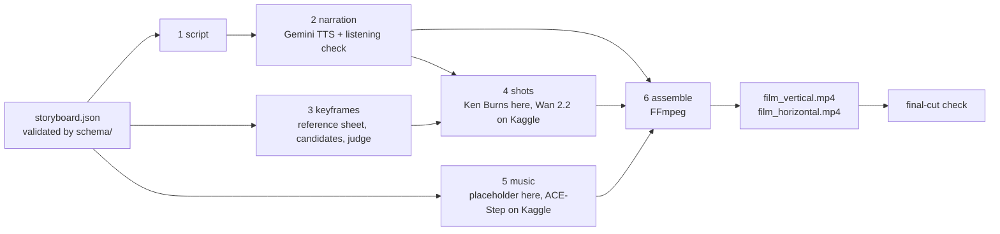

# Architecture

## The shape

One file is the contract. Every stage reads `storyboard.json`, does one job, and writes its outputs plus an index of what it made. No stage calls another stage's code, and no prompt, seed or model name is hidden in code: they are all in the storyboard, so a run can be reproduced and explained from one file.

## Contracts between stages

| Stage | Reads | Writes |
|---|---|---|
| script | storyboard | `outputs/script/index.<lang>.json`: the line and subtitle of every narrated shot |
| narration | script index | `outputs/narration/<shot>__<key>.wav`, `index.<lang>.json` with seconds and the listening score |
| keyframes | storyboard, `ETHICS.md` | `outputs/keyframes/*.png`, originals in `original/`, `index.json` with scores and the pick |
| shots | keyframes index, narration index | `outputs/shots/<shot>_<backend>__<key>.mp4`, `index.<lang>.json`, a GPU job bundle |
| music | storyboard | `outputs/music/*.wav`, `index.json`, a GPU job bundle |
| assemble | all indexes | scene files, the mix, both films, `subtitles.<lang>.srt`, `index.film.<lang>.json` |

Before anything runs, `storyboard.json` is validated twice: against `schema/storyboard.schema.json`, then by checks a schema cannot express (unknown character ids, a pick that points past the candidates, a consent marked recorded with no dated row in `ETHICS.md`). An invalid storyboard stops the run before any model is called.

## Caching: only what changed is regenerated

A stage is a list of units. A unit is one thing to produce plus a **fingerprint**: a dictionary of every input that can change the output. Examples:

| Unit | Fingerprint |
|---|---|
| narration line | text, language, voice, style, model |
| keyframe candidate | full prompt, seed, model, size, keys of the reference sheets |
| Ken Burns clip | keyframe key, camera move, number of frames, size |
| scene (one shot, one export) | clip key, export size, subtitle cues, frames |
| final film | keys of all scenes in order, key of the mix |

`run_units` in `pipeline/core.py` hashes the fingerprint. If a file with that hash exists it is a hit and nothing runs. Otherwise the unit is built, written under a temporary name, renamed into place, and recorded in the stage's `manifest.json` together with its fingerprint. Because the old fingerprint is kept, a miss can say which input changed: `MISS (changed: text)`.

Keys flow downstream. A scene's fingerprint holds its clip's key, and the clip's fingerprint holds its keyframe's key. So a new keyframe prompt regenerates that keyframe, that clip and that scene, and nothing else. Old files are kept, so going back to an earlier prompt is a hit.

`python -m pipeline plan` runs the same code with building switched off. It calls no model and prints what the next run would do.

## Failure handling

| What can go wrong | What the pipeline does |
|---|---|
| Rate limit or quota (HTTP 429), server error, network error | Up to four attempts with a growing wait, using the provider's `Retry-After` when given. Every attempt is one line in `runs.jsonl`. |
| A rejected request (HTTP 400, 401, 403, 404) | No retry. The error names the likely cause (wrong model id, bad key, no access). |
| A provider changes its response shape | Responses are parsed tolerantly: the audio or image is searched for in the JSON, not read from one fixed path. |
| A stopped run | Files are written under a temporary name and renamed when complete, so a half-written file is never used. The next run continues from the cache. |
| The GPU job fails or has not run yet | The shot falls back to a pan and zoom over its keyframe. The index marks it `kenburns_fallback` and the final-cut check lists it. |
| One clip fails on the GPU | The job script catches it, records the error and the peak memory, and goes on to the next clip. `results.json` is rewritten after every clip. |
| A real person's consent is missing | The keyframe is not generated. The shot gets a plain card so the cut still assembles, and the final-cut check fails. |
| The image model ignores or rejects a seed | The call is repeated without it and the log line says `seed_applied: false`. |

## Providers

Request shapes were taken from each provider's documentation on 25 Nov 2026. They live in `pipeline/providers.py`.

| Job | Call |
|---|---|
| Speech | `POST https://generativelanguage.googleapis.com/v1beta/interactions`, model `gemini-3.8-flash-tts`, style given as a `speech_metadata` annotation, a prebuilt voice. Returns WAV, 24 kHz mono. No seed parameter is documented, so speech is logged with `seed: null`. |
| Text, vision, listening | `POST .../v1beta/models/gemini-3.8-flash:generateContent`, with images or audio as inline parts. |
| Images | `POST https://api.cloudflare.com/client/v4/accounts/<id>/ai/run/@cf/black-forest-labs/flux-2-klein-4b` as a multipart form (prompt, width, height, up to four reference images under 512 px). `flux-1-schnell` takes JSON instead, and the client handles both. |
| Video | Wan 2.2 TI2V-5B through Diffusers in `kaggle/wan22_i2v.py`. |
| Music | ACE-Step 1.5 through its Python API in `kaggle/acestep_music.py`. |

## Sound

1. Each narration line is placed on the timeline at its shot's start plus a short lead-in. Picture follows the voice: a shot lasts as long as its line needs and never less than its `min_duration_s`.
2. Voice and score are first brought to known levels (voice -16 LUFS, score -24 LUFS), so the balance is a decision and not a repair.
3. The score is ducked under the voice with FFmpeg's `sidechaincompress` (threshold 0.02, ratio 6, attack 300 ms, release 1500 ms).
4. The mix is normalised in two passes with `loudnorm` to -14 LUFS. The true-peak target is -1.5 dB, which leaves room for the AAC encoder to stay under -1 dB.

## Picture

One encoded scene file per shot per export, subtitles burned in, all with the same encoder settings. The scenes are joined with the concat demuxer and `-c copy`, and the sound is added with `-c:v copy`. Nothing is encoded twice, and changing one shot re-encodes one scene per export.

Subtitles are English, at most two lines of 40 characters, timed in proportion to their length, and placed above the area that phone apps cover with buttons.

## One hard decision: two aspect ratios from one GPU budget

The brief wants 9:16 and 16:9. Generating every shot twice would double the image calls and, worse, the GPU time, which is the scarce thing here.

Options I considered:

| Option | Cost | Result |
|---|---|---|
| Generate each shot in both shapes | 2x GPU time | Best framing, not affordable |
| Vertical master, horizontal with blurred bars | 1x | Good vertical, weak horizontal |
| Horizontal master, crop for vertical | 1x | Vertical loses two thirds of the frame |
| **Square master, crop both ways** | 1x | Each export keeps 56% of the frame, full-bleed in both |

I chose the square master (1024 x 1024). Every keyframe prompt puts the subject in the centre, and the style block says so, which is what makes a centre crop safe. The rule is in code, not in my head: when a crop would lose more than 45% of a clip it is placed over a blurred copy of itself instead. With square clips that rule never fires, but it protects the film if a clip comes back in another shape.

The price is sharpness: the vertical export enlarges a 576-pixel-wide crop to 1080. A painted, grainy look hides that better than a photographic one would, which is one reason for the style. Whether viewers notice is an open question, and it is on the experiment list.

## What is not here

- No web service and no database. Files and hashes are enough at this size.
- No automatic push to Kaggle. The job bundle is uploaded by hand, because an automation I cannot test is worse than three documented clicks.
- No voice cloning. The narrator is a prebuilt voice.
