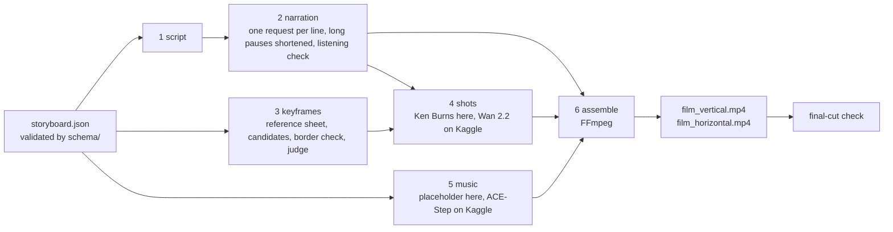

# Architecture

## The shape

One file is the contract. Every stage reads `storyboard.json`, does one job, and writes its outputs plus an index of what it made. No stage calls another stage's code, and no prompt, seed or model name is hidden in code: they are all in the storyboard, so a run can be reproduced and explained from one file.

## Contracts between stages

| Stage | Reads | Writes |
|---|---|---|
| script | storyboard | `outputs/script/index.<lang>.json`: the line and subtitle of every narrated shot |
| narration | script index | each line as it was spoken in `outputs/narration/<shot>__<key>.wav`, the same line with its long pauses shortened in `<shot>_tight__<key>.wav`, a take in `takes/` when one was made, `index.<lang>.json` with seconds, the listening score and, when the listener is a speech model, the time of each word it heard |
| keyframes | storyboard, `ETHICS.md` | the model's pictures in `outputs/keyframes/original/`, keyframes cut from them, `index.json` with the border count, the scores and the pick |
| shots | keyframes index, narration index | `outputs/shots/<shot>_<backend>__<key>.mp4`, `index.<lang>.json`, a GPU job folder |
| music | storyboard | `outputs/music/*.wav`, `index.json`, a GPU job folder |
| assemble | all indexes | scene files, the mix, both films, `subtitles.<lang>.srt`, `index.film.<lang>.json` |

Before anything runs, `storyboard.json` is validated twice: against `schema/storyboard.schema.json`, then by checks a schema cannot express (unknown character ids, a pick that points past the candidates, a consent marked recorded with no dated row in `ETHICS.md`). An invalid storyboard stops the run before any model is called.

## Caching: only what changed is regenerated

A stage is a list of units. A unit is one thing to produce plus a **fingerprint**: a dictionary of every input that can change the output. Examples:

| Unit | Fingerprint |
|---|---|
| narration line | text, language, voice, style, model, and the seed when one is set |
| keyframe candidate | full prompt (style, shot, and the description of each character in it), seed, model, size, keys of the reference sheets it is given |
| listening check | the audio itself, the line, the listener model |
| Ken Burns clip | keyframe key, camera move, number of frames, size |
| scene (one shot, one export) | clip key, export size, subtitle cues, frames, the crop anchor of that export (`focus_x`, `focus_y`) |
| final film | keys of all scenes in order, key of the mix |

`run_units` in `pipeline/core.py` hashes the fingerprint. If a file with that hash exists it is a hit and nothing runs. Otherwise the unit is built, written under a temporary name, renamed into place, and recorded in the stage's `manifest.json` together with its fingerprint. Because the old fingerprint is kept, a miss can say which input changed: `MISS (changed: text)`.

Keys flow downstream. A scene's fingerprint holds its clip's key, and the clip's fingerprint holds its keyframe's key. So a new keyframe prompt regenerates that keyframe, that clip and that scene, and nothing else. Old files are kept, so going back to an earlier prompt is a hit.

`python -m pipeline plan` runs the same code with building switched off. It calls no model and prints what the next run would do.

### What the model sent is kept as it came

Two stages keep the model's answer untouched and cut what the film needs from it with FFmpeg:

- **Pictures.** Each answer of the image model is stored in `outputs/keyframes/original/` under a hash of what was sent to the model. The keyframe is cut from that file: scaled to the master size, with `format.edge_trim` taken off each side. The model is called only when no original exists, so a change to the cut costs nothing. A character is held from shot to shot by its description, which goes into the prompt of every shot it is in and names the colours of its clothes. A shot can also be given the character's reference picture (`keyframe.reference`, on unless a shot switches it off). In this film every shot with a person is drawn from the words alone: the reference picture forced one layout on every shot (E24), and with two reference pictures the model drew neither scene (E28). A shot can name small boxes of its picture to be blurred when the keyframe is cut (`keyframe.soften`), for marks that read like writing on a sign: the model is not asked again, and the public page shows the picture the same way.
- **Narration.** Each line is spoken in a request of its own and kept as it came (`voice.one_take` is false in the storyboard). With a voice of Addis AI the request holds the text, the voice and the language: that API has no take, no style and no seed. With the Gemini speech model every request carries `voice.style` and, when it is set, the same `voice.seed`. For that model a take is still possible (`voice.one_take`): the missing lines go into one request with a `<long pause>` tag between them, the answer is kept in `outputs/narration/takes/`, and a line is cut from it only where the longest pauses and the transcribed words put both of its ends in the same place. Any other line is spoken alone: nothing is guessed (F04 in `FAILURES.md`). Silences inside a line that are longer than `voice.max_pause_s` are shortened by FFmpeg from the kept audio, so a new limit costs no speech request. The listening check names the language: in the question to the text model (E21), or as a parameter when the storyboard names a speech-to-text model as `models.listener`. A speech model is sent each line with silence before and after it, and its answer is looked at twice: the match of the whole line, and the first and the last word on their own, because that is where a voice leaves a word out (F12). An Addis voice is sent its line without a comma after the first word (E29), and `voice.takes` asks for a further take of one line: the earlier takes stay in the cache. Which take is kept was decided by what two listening models wrote for each (E30).

The take was there because of a limit, not taste: the free Gemini speech tier allows ten requests a day, and a request per line spends eight of them on one pass. It is switched off because lines from a take and from single requests did not sound like one voice (F10 in `FAILURES.md`, E25 in `EXPERIMENTS.md`).

## The run log

`runs.jsonl` gets one line for every attempt of every real model call, failed attempts too. Fields on every line:

| Field | Meaning |
|---|---|
| `ts`, `run_id` | when, and which run of the pipeline |
| `stage`, `unit` | which stage, and which unit of work (`s04`, `s07_c2_judge`, `take`) |
| `provider`, `model` | who was called |
| `params`, `seed` | what was asked: sizes, voice, style, hashes of the prompt text. `seed` is null where the provider has none |
| `attempt`, `status` | 1 to 4, `ok` or `error`. An error line has `http_status` and the provider's message |
| `latency_s` | measured around the request |
| `cost_usd` | the list price of the call, 0 for a failed attempt, null when the price or the usage is not known. For a call on a free tier or on a sign-up credit it is what the call would have cost. For Claude, which has neither, it is what was paid. For pictures, the part of a day over the free allowance is paid since the account moved to a paid plan (`COSTS.md`). The first 35 lines of the log, up to 11:18 UTC on 25 Nov, were written before this field existed and do not have it: the log is never rewritten |

A successful line also carries what its price depends on: token counts for text, seconds of audio for speech, and for GPU work the minutes and the peak memory that the job measured itself. Prices and their sources are in `pricing.json`, and the arithmetic is in `pipeline/pricing.py`.

## Failure handling

| What can go wrong | What the pipeline does |
|---|---|
| A server error, a network error or a timeout | Up to four attempts, with waits of 10, 30 and 90 seconds, or the provider's `Retry-After` when given. Every attempt is one line in `runs.jsonl`. The first waits were 2, 4 and 8 seconds, which an overloaded model outlasted (F01). |
| A free-tier limit | The limits that apply to this project are in `pricing.json`, and the run log is the counter. Before each request the day's use is read: over a daily limit the request is not sent and the message says when the allowance resets, and a per-minute limit is waited out. Where the account pays for what goes over a free daily allowance (`then_paid_from` in `pricing.json`, the picture model since 25 Nov), the request is sent and the run says once that calls are paid for from there. When a key is replaced, `counted_from` says from when the log is counted (F09). |
| A rejected request (HTTP 400, 401, 403, 404) | No retry. The error names the likely cause (wrong model id, bad key, no access). |
| A check cannot reach its model | The picture judge, the subtitle check and the listening check only measure, so they are optional units: the stage goes on without the result, the final-cut check lists what is missing, and the next run tries again. |
| A voice leaves out a word at the start or the end of a line | The listening check reports a first or last word that was not heard, and the final-cut check lists the line. `voice.takes` in the storyboard asks the voice for that line again. |
| A provider changes its response shape | Responses are parsed tolerantly: the audio or image is searched for in the JSON, not read from one fixed path. |
| A stopped run | Files are written under a temporary name and renamed when complete, so a half-written file is never used. The next run continues from the cache. |
| A picture comes back with a paper border | Each candidate's four sides are measured for bare paper. The pick prefers the candidate with the fewest, and the final-cut check lists a pick that still has a border. |
| A take cannot be cut into its lines with certainty (only when `voice.one_take` is on, with the Gemini speech model) | The lines that the pauses and the words agree on are kept. Each other line is spoken again alone. The take is kept, so a better way of cutting costs no speech request. |
| The GPU job fails or has not run yet | The shot falls back to a pan and zoom over its keyframe. The index marks it `kenburns_fallback` and the final-cut check lists it. |
| One clip fails on the GPU | The job script catches it, records the error and the peak memory, and goes on to the next clip. `results.json` is rewritten after every clip. |
| A generated clip is shorter than its shot | It is slowed by at most 25%. The rest of the shot is a slow push in over the clip's last frame, so the picture never freezes under the voice. The final-cut check lists the shots and the seconds. A shot can allow its clip to be slowed further (`motion.slow_max`). Beyond 25% the frames are blended into one another, so the slow motion does not stutter. |
| A real person's consent is missing | The keyframe is not generated. The shot gets a plain card so the cut still assembles, and the final-cut check fails. |
| The image model ignores or rejects a seed | The call is repeated without it and the log line says `seed_applied: false`. |

## Providers

Request shapes were taken from each provider's documentation on 25 Nov 2026, and for Addis AI on 26 Nov. They live in `pipeline/providers.py`.

| Job | Call |
|---|---|
| Speech, Addis AI (while `models.tts` starts with `addis-`) | `POST https://api.addisassistant.com/api/v1/voice/generations` with the text, a voice id, the language and the format `wav_44100`. The answer holds an address of the audio, which is fetched at once. No style and no seed, so these lines are logged with `seed: null`. `python -m pipeline voices` lists the voices for the narration language. |
| Speech, Gemini (any other `models.tts`) | `POST https://generativelanguage.googleapis.com/v1beta/interactions`, model `gemini-3.8-flash-tts`, style given as a `speech_metadata` annotation, a prebuilt voice, and a seed in `generation_config` when `voice.seed` is set. A take is one text with the `<long pause>` tag between its lines. Returns WAV, 24 kHz mono. |
| Text, vision, and listening while no `models.listener` is named | `POST .../v1beta/models/gemini-3.5-flash-lite:generateContent`, with images or audio as inline parts. |
| Listening, Addis AI (while `models.listener` starts with `addis-`) | `POST https://api.addisassistant.com/api/v1/scribe/transcribe?language=<code>&timestamps=word&format=json`, the audio as a multipart file. The answer holds the text it heard and the start and end of each word. |
| Picture judge, subtitle check | `claude-opus-5-5` through the Anthropic SDK, with a JSON schema for the answer. Used while `models.judge` names it. It takes pictures and text, not audio. |
| Images | `POST https://api.cloudflare.com/client/v4/accounts/<id>/ai/run/@cf/black-forest-labs/flux-2-klein-4b` as a multipart form (prompt, width, height, up to four reference images under 512 px). `flux-1-schnell` takes JSON instead, and the client handles both. |
| Video | Wan 2.2 TI2V-5B through Diffusers in `kaggle/wan22_i2v.py`, run on Kaggle by `pipeline/kagglerun.py`. |
| Music | ACE-Step 1.5 through its Python API in `kaggle/acestep_music.py`, run the same way. |

## Sound

1. Each narration line is placed on the timeline at its shot's start plus a short lead-in. Picture follows the voice: a shot lasts as long as its line needs and never less than its `min_duration_s`.
2. Voice and score are first brought to known levels (voice -16 LUFS, score -24 LUFS), so the balance is a decision and not a repair. Each narration line is levelled on its own: lines that come from different speech requests differed by 4 dB in the first mix.
3. The score is ducked under the voice with FFmpeg's `sidechaincompress` (threshold 0.02, ratio 6, attack 300 ms, release 1500 ms). Both of its inputs are cut into blocks of 1024 samples first: with blocks of different sizes a FLAC score came out 1.3 s short.
4. The mix is brought toward -14 LUFS with one fixed gain. It is measured with FFmpeg's EBU R128 meter. If the gain it needs would push a peak over -1.7 dBTP, the peaks in the way are limited once (`alimiter`, 5 ms attack, 50 ms release), the mix is measured again, and the gain is as large as the peaks then allow. The index of the mix records the gain and the limiter's ceiling. The first real cut landed at -15.0 LUFS and -1.5 dBTP after the AAC encoder. The cut of 26 November, with a voice that has lower peaks, lands at -14.0 LUFS and -1.8 dBTP.

The brief suggests `loudnorm` in two passes for this step, and the pipeline used it at first. Measuring the mix (E12 in `EXPERIMENTS.md`) showed three things that were wrong: the voice track clipped before the loudness pass, a FLAC score lost the end of its fade, and `loudnorm` did not apply the fixed gain it was asked for. With a voice as peaky as this one it switches to riding the gain up and down, without saying so, which moves the balance that steps 2 and 3 have just set. So the last step is done in the open. Two prices are paid for that: the first cuts were up to one LU quieter than the platforms' reference, because limiting harder to win it back made the encoded peaks overshoot, and the limiter delays the sound by about 5 ms.

A score that is shorter than the film would start again from its first note under the last words. When up to 13% is missing, it is played that much slower at the same pitch instead (`atempo`), and the mix report says so (`music_tempo`). The cut of 26 November is 85.2 s long and its score 80 s, so the score runs 6% slower.

## Picture

One encoded scene file per shot per export, subtitles burned in, all with the same encoder settings. The scenes are joined with the concat demuxer and `-c copy`, and the sound is added with `-c:v copy`. Nothing is encoded twice, and changing one shot re-encodes one scene per export.

A shot lasts as long as its narration, and a generated clip lasts a few seconds. A clip that is too short is slowed by at most 25%, and what is still missing is a slow push in over its last frame, made in the same filter as the clip so nothing changes where the two meet. The road shot allows its clip to be slowed to about half speed (`"slow_max": 2.1`), with blended frames, because a distant bus and its dust can move that slowly. In the cut of 26 November its shot is 5.0 s and its clip 3.4 s, so the clip runs one and a half times slower.

The two exports cut the square picture on different sides: the wide film loses height and the tall film loses width. So a shot says where its subject sits with `keyframe.focus_x` (0 left, 1 right) and `keyframe.focus_y` (0 top, 1 bottom), each as one number for every export or as one number per export: `{"vertical": 0.3, "horizontal": 0.5}`. The crop keeps that part, an export that is not named keeps the middle, and a changed anchor re-encodes that one scene.

Subtitles are English, at most two lines of 40 characters. In the tall film they stand 672 px above the bottom and between 203 and 878 px from the left, which is clear of the areas that YouTube Shorts, TikTok and Instagram Reels ask to keep free of text (E31 in `EXPERIMENTS.md`). A subtitle is taken sentence by sentence, and each sentence is on screen while its sentence is spoken. When the listener is a speech model, that time comes from the words it heard: the words of the script are matched to the heard words in order, so a word that was misheard or split in two moves nothing. Without word times it is worked out from the number of letters in each spoken sentence and from the measured pauses. On the eight lines the film had when this was measured, that estimate was 0.26 s away from the heard words on average and 0.53 s at most (E27). A semicolon ends a spoken piece as a full stop does, in both scripts, so that a line and its subtitle fall into the same number of pieces. A question in quotation marks stays inside its sentence. Short sentences share a cue until it has been up for 1.5 s and can be read at 20 characters a second, a colon always ends a cue, and a sentence too long for one cue is cut after a comma. Two lines of a cue are broken where they come out nearest in length, so no line is one left-over word (`subtitle_cues` in `pipeline/core.py`).

## One hard decision: two aspect ratios from one GPU budget

The brief wants 9:16 and 16:9. Generating every shot twice would double the image calls and, worse, the GPU time, which is the scarce thing here.

Options I considered:

| Option | Cost | Result |
|---|---|---|
| Generate each shot in both shapes | 2x GPU time | Best framing, not affordable |
| Vertical master, horizontal with blurred bars | 1x | Good vertical, weak horizontal |
| Horizontal master, crop for vertical | 1x | Vertical loses two thirds of the frame |
| **Square master, crop both ways** | 1x | Each export keeps 56% of the frame, full-bleed in both |

I chose the square master (1024 x 1024). The style block asks for the subject in the centre of the frame, and I took that to make a centre crop safe. It was not, in either direction. The wide film keeps the middle band of the square, and a standing figure lost its head there. The tall film keeps the middle of the width, and the subject does not always sit there: the brokers' shot and the room shot were the first to get a sideways anchor of their own for the tall film (commit `c323726`). So a shot can say where its subject sits, with `keyframe.focus_x` and `keyframe.focus_y`, each as one number or as one number per export, and the crop keeps that part (see "Picture" above). The rule is in code, not in my head: when a crop would lose more than 45% of a clip it is placed over a blurred copy of itself instead. With square clips that rule never fires, but it protects the film if a clip comes back in another shape.

The price is sharpness: the vertical export enlarges a 576-pixel-wide crop to 1080. A painted, grainy look hides that better than a photographic one would, which is one reason for the style. Whether viewers notice is an open question, and it is on the experiment list.

## What is not here

- No web service and no database. Files and hashes are enough at this size.
- No GPU on this machine and no paid GPU. The two GPU jobs go to Kaggle through its command line tool and come back as files.
- No scheduler and no queue. The stages run in order in one process, and the only waiting is for Kaggle.
- No voice cloning. The narrator is a prebuilt voice.
